# ML for Snow Water Equivalent (SWE) and Snow Depth from SNOWCAP data

This document describes the workflow and requirements for combining Snowcap SWE and snow depth as targets with meteorological and satellite data to forecast snow conditions with XGBoost.

The trained model downscales and corrects ECMWF forecasts to daily 500 m SWE: the 15 day ensemble (ECXENS) and the seasonal forecast of 215 days (ECXSF). Results are shown in the SnowLook dashboard ([snowlook.cryo-scope.eu](https://snowlook.cryo-scope.eu)).

Work done in the [CryoSCOPE](https://cryoscope-project.eu/) project.

Anni Kröger (2026), Finnish Meteorological Institute (FMI)

## Contents

1. [Target: SNOWCAP SWE and snow depth](#target-snowcap-swe-and-snow-depth)
2. [Workflow](#workflow)
3. [Training locations](#training-locations)
4. [Training data and features](#training-data-and-features)
5. [Training](#training)
6. [Independent validation](#independent-validation)
7. [Predictions](#predictions)
8. [Forecast validation](#forecast-validation)
9. [SnowLook dashboard](#snowlook-dashboard)
10. [Model editions](#model-editions)
11. [Requirements](#requirements)

## Target: SNOWCAP SWE and snow depth

|target in ML|units|spatial coverage|spatial resolution|temporal coverage|xgb name|
|:-|:-|:-|:-|:-|:-|
|Snow Water Equivalent|mm|Fenno-Scandinavia / Alps|500m|2015-2023 / 2016-2024|swe|
|Snow depth|m|Fenno-Scandinavia / Alps|500m|2015-2023 / 2016-2024|sde|

https://snowcap.info/

## Workflow

```
1. feature space coverage sampling   choose the training and validation locations per domain (FSCS)
2. training data                     fetch time series at the locations: SNOWCAP target, ERA5-Land, ERA5, static maps
3. merge                             one wide table: location, day, target, features
4. training                          XGBoost + Optuna, split by snow season
5. independent validation            the validation locations, never used in training
6. predictions                       run the model on ECMWF forecasts: ECXENS (15 days) and ECXSF (215 days)
7. forecast validation               ECXENS and ECXSF against SNOWCAP (and ERA5-Land at 9 km)
8. SnowLook                          dashboard of training, validation and predictions
```

## Training locations

|domain|countries|training period (snow seasons)|
|:-|:-|:-|
|Fenno-Scandinavia|Norway, Sweden, Finland|2015-09-01 to 2023-09-01|
|Alps|the six Alpine countries|2016-09-01 to 2024-09-01|

The two domains are trained together as one model (`both`); a `tag` column tells them apart in the data.

Training and validation locations are chosen with feature space coverage sampling (FSCS), so that the locations cover the range of terrain and forest in each domain.

TODO: describe the FSCS inputs (elevation, slope, aspect, forest canopy height 2021) and settings.

- Scandinavia: W_SPACE = 2.5, about 7.66 M valid 500 m cells to choose from, 10 000 locations
- Alps: W_SPACE = 2.0, about 1.43 M valid 500 m cells to choose from, 10 000 locations
- a separate set of 10 000 validation locations per domain, disjoint from the training locations

References for the method: Brus (2019), Ma et al. (2020), Minasny & McBratney (2006), Wadoux et al. (2019), Nourani et al. (2022).

### Fenno-Scandinavia

|elevation|slope|aspect|forest canopy height 2021|
|:-:|:-:|:-:|:-:|
|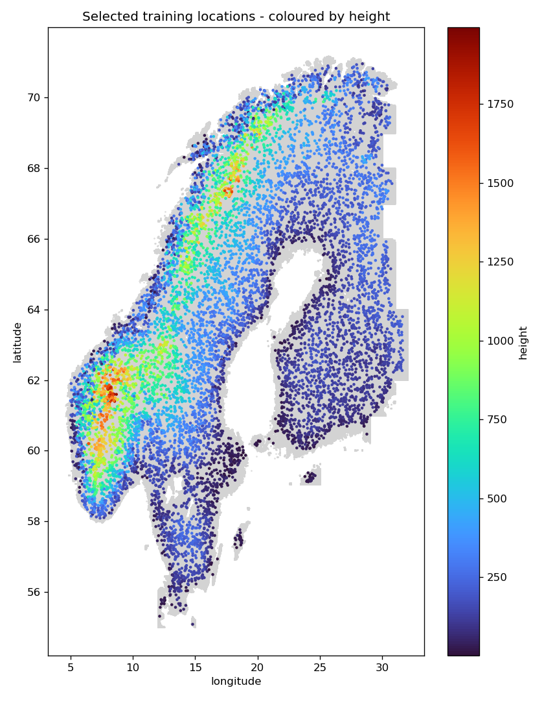|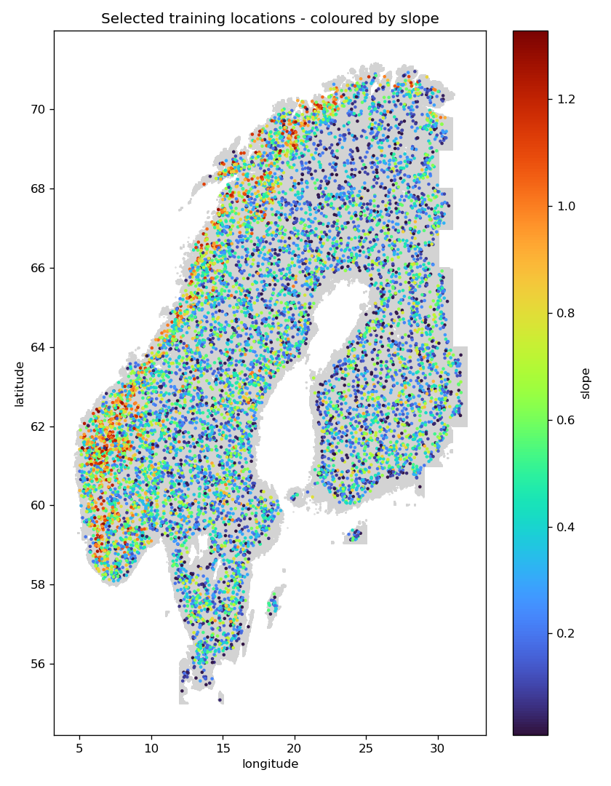|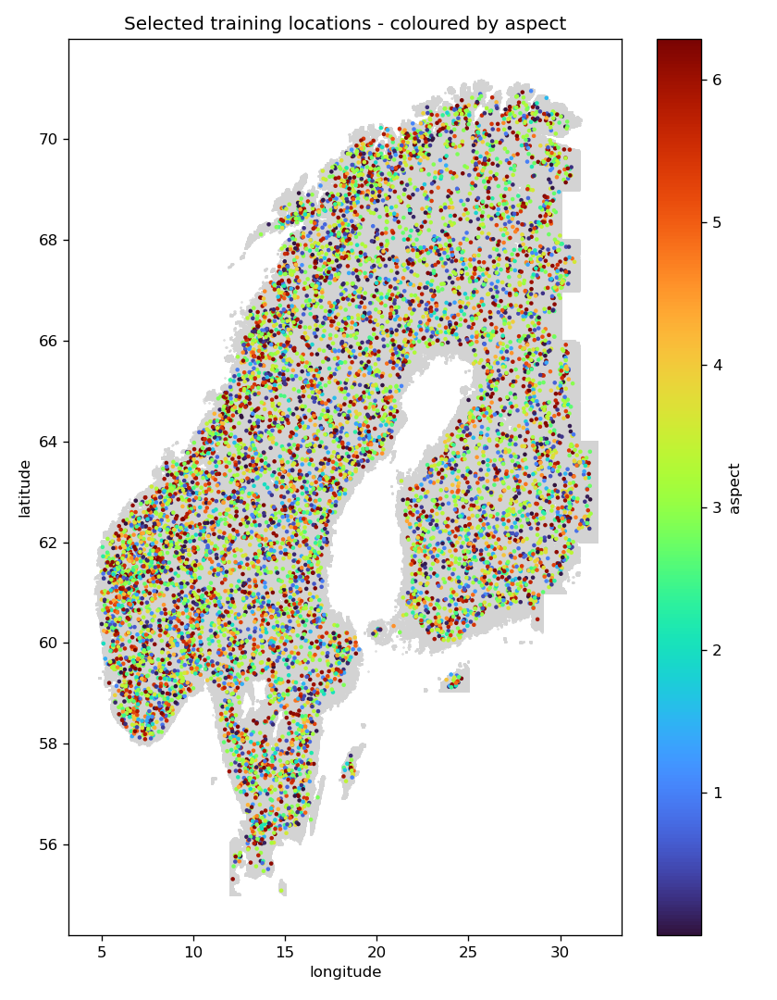|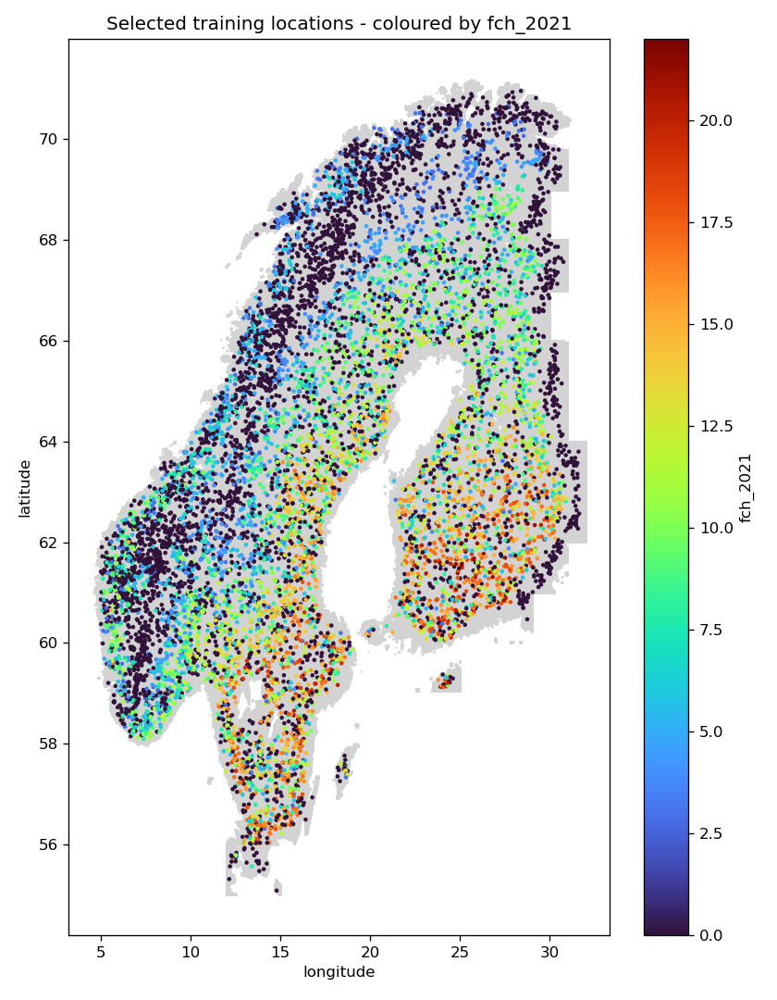|

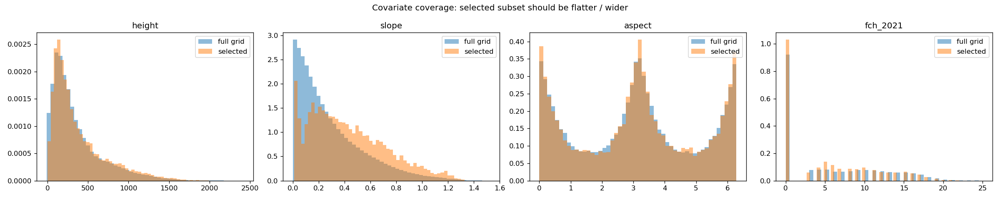

### Alps

|elevation|slope|aspect|forest canopy height 2021|
|:-:|:-:|:-:|:-:|
|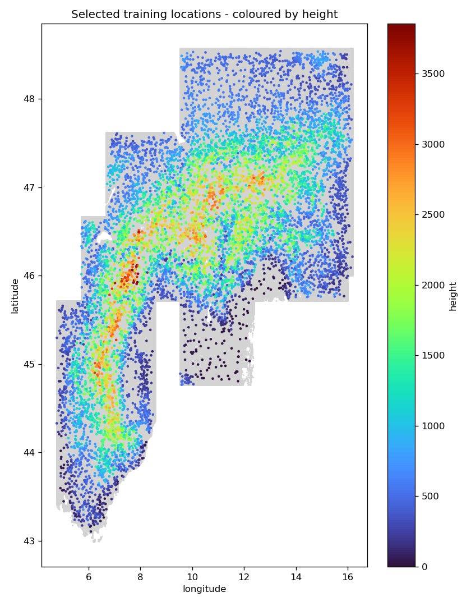|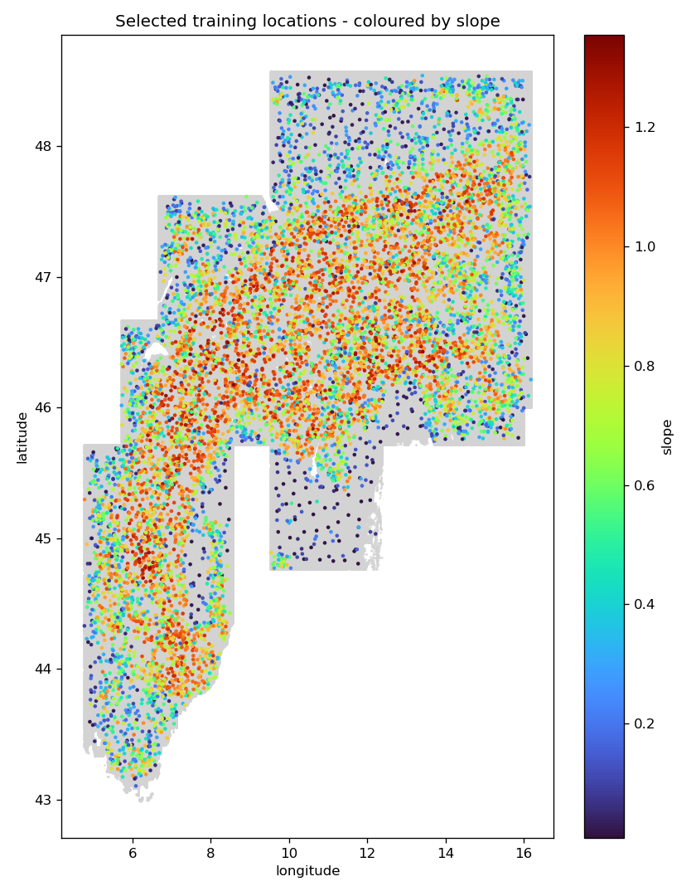|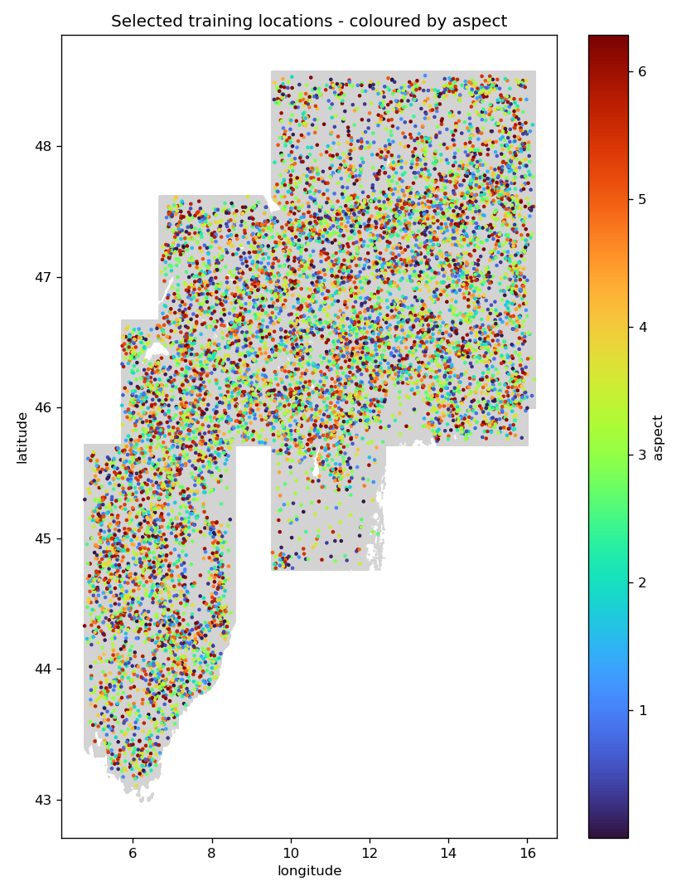|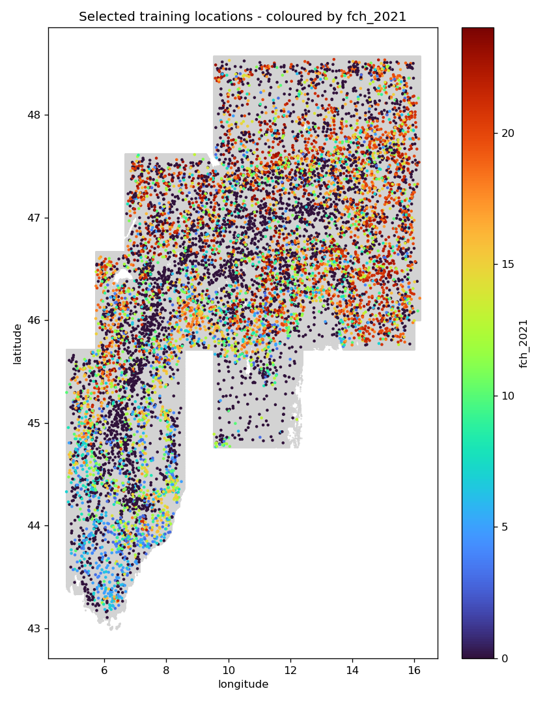|

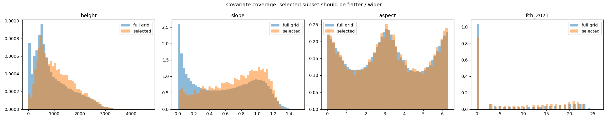

### Validation locations

|Fenno-Scandinavia|Alps|
|:-:|:-:|
|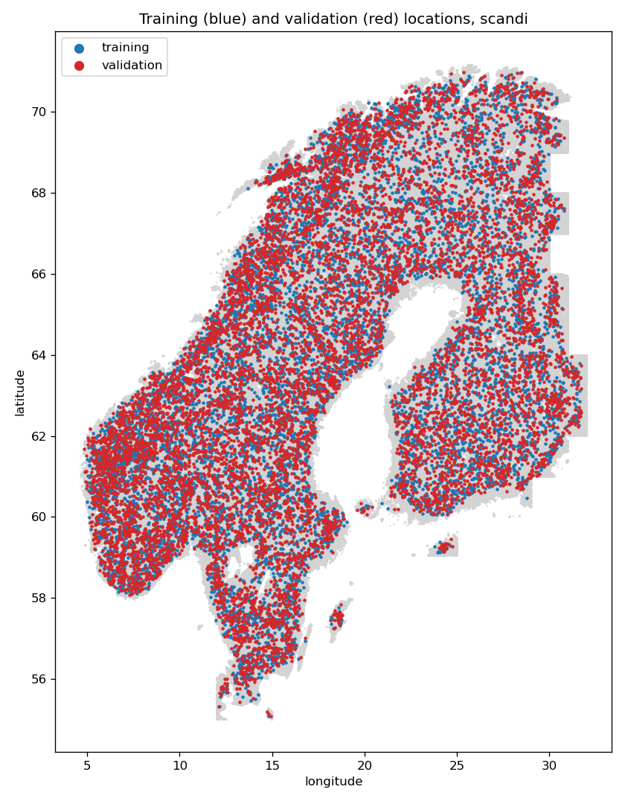|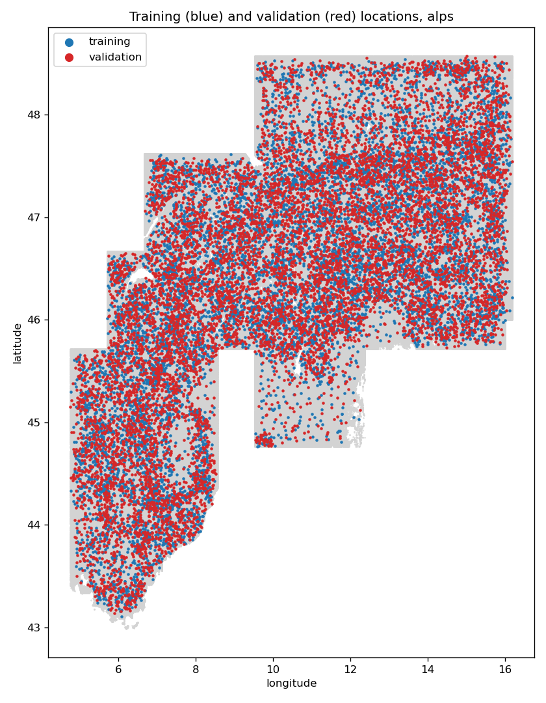|

## Training data and features

Features of the final model swe-ml-2. Latitude and longitude are read (for the per location lag and checks) but are not features: the model has to learn SWE from terrain and weather, not from where a point is.

|group|feature|description|units|source|
|:-|:-|:-|:-|:-|
|terrain|height|elevation|m|DEM|
|terrain|slope|terrain slope|°|DEM|
|terrain|aspect|terrain aspect|°|DEM|
|terrain|tpi|topographic position index|m|DEM|
|terrain|dtw|distance to water|m|TODO|
|terrain|dto|distance to ocean|m|TODO|
|land cover|tcf|tree cover fraction|0..1|TODO|
|precipitation|tp|total precipitation|m|ERA5-Land|
|precipitation|sf|snowfall|m w.e.|ERA5-Land|
|energy|ssr, str, slhf, sshf|surface net solar and thermal radiation, latent and sensible heat flux|J m⁻²|ERA5-Land|
|temperature|t2_00|2 m temperature, 00 UTC|K|ERA5-Land|
|temperature|tmax_max|daily maximum 2 m temperature|K|ERA5-Land daily|
|temperature|stl1_00|soil temperature, level 1|K|ERA5-Land|
|upper air|t500_00, t700_00, t850_00|temperature at 500, 700 and 850 hPa|K|ERA5 pressure levels|
|snow and hydrology|sd_00, sd_00_lag1|snow depth water equivalent, same day and previous day|m w.e.|ERA5-Land|
|snow and hydrology|rsn_00|snow density|kg m⁻³|ERA5-Land|
|snow and hydrology|ro, e|runoff, total evaporation|m, m w.e.|ERA5-Land|
|time|doy_sin, doy_cos|day of year (left out from swe-ml-3)||date|

- time series are fetched from the SmartMet timeseries API with WKT MULTIPOINT geometries, in batches of 5000 locations; static features with gdallocationinfo from the rasters
- everything is merged into one wide table, both domains together: `training_all_scandi_alps_ext_tpi.csv.gz`
- `sd_00_lag1` is computed per location on the continuous series before the train / validation split, and is NaN when the previous day is missing
- SNOWCAP climatology features (swe_mean, swe_max, ...) were used in older editions and are left out since FIN5noclim
- TODO: static features can hold -9999 fill codes; convert them to NaN in training and in the prediction scripts

## Training

<!-- Script: `xgb-train-cryoscope-swe.py <optuna_tag>` -->

- objective `reg:tweedie` (log link: predictions are always positive and many zeros are handled), `tweedie_variance_power` tuned between 1.1 and 1.9
- split by snow season (1 Sep to 31 Aug, labelled by the start year): validation seasons 2018 (low snow winter 2018/19) and 2021 (high snow winter 2021/22), every other season is training
- Optuna multi-objective tuning (50 trials, TPE sampler): minimize validation RMSE and maximize validation KGE. KGE penalizes too small variability, so high SWE is not flattened
- the final trial is picked from the Pareto front: highest KGE with RMSE at most 5 % above the front's best RMSE (`RMSE_TOL`)
- up to 1500 trees, early stopping after 50 rounds
- `DROP_TIME=True` leaves out doy_sin and doy_cos (swe-ml-3)

Outputs (`<stem>` = `cryoscope-SWE_both_<optuna_tag>`):

|file|content|
|:-|:-|
|`models/mdl_swe_<stem>.json`|the XGBoost model|
|`models/hyperparams_swe_<stem>.json`|chosen parameters, feature list, split, validation scores|
|`results/optuna_pareto_<stem>.csv`, `optuna_history_<stem>.png`|Pareto front and tuning history|
|`results/gain_importance_<stem>.csv`, `shap_importance_<stem>.csv`|feature importance|
|`results/shap_beeswarm_<stem>.png`, `shap_bar_<stem>.png`, `shap_dep_<feature>_<stem>.png`|SHAP figures (log SWE margin)|
|`results/valid_scatter_<stem>.png`, `eda_*_<stem>.png`|fit and data checks|

The validation scores written by the training script are optimistic, because the same seasons drove tuning and early stopping. Use the independent validation for the model performance.

## Independent validation

<!-- Script: `xgb-validate-cryo-swe.py <optuna_tag>`, data fetched with `ts-snowmodel-valid.py` -->

- 10 000 validation locations per domain, never used in training
- baselines: ERA5-Land SWE and SNOWCAP climatology
- scores: RMSE, ubRMSE, ME, MAE, R², KGE, MSE skill against each baseline, POD, FAR, CSI, HSS (1 mm), per domain, month, snow year and snow season (peak SWE, onset, melt out)
- outputs in `validationresults_<optuna_tag>/`

TODO: results of the final model.

## Predictions

|product|forcing|length|grid|domain|
|:-|:-|:-|:-|:-|
|ECXENS|ECMWF ensemble (ECENS), 50 members|15 days, daily|500 m|Scandinavia, Alps|
|ECXSF|ECMWF seasonal forecast (ECSF), 51 members|215 days|2.8 km (0.025°)|Scandinavia, Alps|
|ECXSF 9 km|ECMWF seasonal forecast|215 days|9 km|Europe|

<!-- scripts: ECXENS TODO; ECXSF `run-xgb-predict-swe-sf.sh`, `xgb-predict-swe-sf.py`; ECXSF 9 km TODO -->

- the first forecast day's sd lag comes from ERA5-Land sd of the start day
- the predictions take the feature list of the model from its hyperparams json
- the newest runs are on the SmartMet server (sm.cryo-scope.eu) as WMS layers and time series

## Forecast validation

Past forecasts of chosen start dates (cases) are validated against SNOWCAP. The cases and their sources are listed on the SnowLook pages.

**ECXENS, 15 days, 500 m**

<!--
```
./prep-ecxens-validation.sh 20191210
python cryo-ecxens-performance.py 20191210 swe-ml-2
```
prep-ecxens-validation.sh: cuts SNOWCAP to the forecast days, splits ECENS and ECXENS to members, makes the ensemble means and remaps the ECENS ensemble mean to the SNOWCAP 500 m grid
cryo-ecxens-performance.py: the validation below
-->

- input: SNOWCAP of the forecast days, ECENS and ECXENS members and ensemble means, and the ECENS ensemble mean remapped to the SNOWCAP 500 m grid
- output: daily maps (raw ECENS 9 km, ECENS remapped 500 m, ECXENS, SNOWCAP), bias maps, scores per lead day, the domain mean time series and the member ranking (driest, wettest), in `ecxens_validation/<model>/<start date>/<prediction>/`

**ECXSF, seasonal**

- 2.8 km: monthly means against SNOWCAP, results in `validation_sf/<model>/<start date>/<prediction>/`
- 9 km: monthly means against ERA5-Land per region, results in `validation_sf9km/`
<!-- scripts: 2.8 km `xgb-validate-swe-sf.py`, 9 km `xgb-validate-swe-sf-9km.py` -->

## SnowLook dashboard

Streamlit app, served at [snowlook.cryo-scope.eu](https://snowlook.cryo-scope.eu) from a docker container.
<!-- app `snowlook/snowlook.py`, setup `snowlook/snowlook_setup.md` -->

|section|pages|
|:-|:-|
|Latest SWE predictions|web map of the newest runs, member time series of a clicked spot|
|Final model|training and model performance, independent validation|
|All model versions|training explorer, validation explorer|
|SWE predictions (past)|15 days (500 m), seasonal 215 days (2.8 km), seasonal 215 days (9 km)|
|Compare model predictions|10 and 15 days, seasonal|

## Model editions

|edition|what changed|
|:-|:-|
|FINmulti|first multi domain model|
|MANYfeatures|feature test with every fetched variable (64 features)|
|FIN2multiNoMax|swe_max and snowdepth_max left out|
|FIN5noclim|SNOWCAP climatology features left out, 10 day ECXENS|
|SnowWaterEq|TODO|
|swe-ml-2|final model: multi-objective tuning, pressure level temperatures, 15 day ECXENS|
|swe-ml-3|swe-ml-2 without the day of year features (test)|

## Requirements

- Python 3.12 (conda env `xgb`): xgboost, optuna (≥ 3.0 for multi-objective), shap, scikit-learn, pandas, numpy, matplotlib
- forecast validation: xarray, cfgrib, eccodes; optional cartopy and shapely for coastlines
- data tools: cdo, eccodes (grib_copy), GNU parallel, gdal (gdallocationinfo)
- SnowLook: streamlit, plotly, folium, streamlit-folium, requests, pyarrow, pillow
- access to the SmartMet timeseries API and the static rasters

<!--
## Scripts

|script|description|
|:-|:-|
|TODO (feature space coverage sampling)||
|TODO (training data fetch)||
|`ts-snowmodel-valid.py`||
|`merge-snowmodel-cryo-trainingdata.py`||
|`xgb-train-cryoscope-swe.py`||
|`xgb-validate-cryo-swe.py`||
|`run-xgb-predict-swe-sf.sh`||
|`xgb-predict-swe-sf.py`||
|`prep-ecxens-validation.sh`||
|`cryo-ecxens-performance.py`||
|`xgb-validate-swe-sf.py`||
|`xgb-validate-swe-sf-9km.py`||
|`snowlook/snowlook.py`||
-->